<div align="center">

<picture>
  <source media="(prefers-color-scheme: light)" srcset="docs/banner-light.svg">
  
</picture>

<br>

**An ad-free desktop music player for the YouTube Music catalogue.**
<br>
Synced lyrics · crossfade · 5-band EQ · offline songs · podcasts · listening Recap

<br>

[](https://github.com/Hiroyki/Svara/releases/latest)
[](https://github.com/Hiroyki/Svara/releases)
[](#-download)
[](LICENSE)
<br>
[](https://github.com/Hiroyki/Svara/actions/workflows/ci.yml)
[](https://github.com/Hiroyki/Svara/stargazers)
[](https://github.com/Hiroyki/Svara/commits/main)
[](https://github.com/Hiroyki/Svara/issues)


[](#-made-in-indonesia)

<br>

<a href="https://github.com/Hiroyki/Svara/releases/latest/download/Svara-Setup-2.0.0.exe"></a>
&nbsp;&nbsp;
<a href="https://github.com/Hiroyki/Svara/releases/latest/download/Svara-2.0.0.dmg"></a>

<sub>Windows 10/11 64-bit · macOS 13+ (Apple Silicon & Intel) · nothing else to install</sub>

<br><br>

<picture>
  <source media="(prefers-color-scheme: light)" srcset="docs/home-light.jpg">
  
</picture>

<br>

| 🚫 **No ads** | 📝 **Karaoke lyrics** | 🎛️ **EQ + crossfade** | 💾 **Offline songs** | 🔒 **No account** |
| :---: | :---: | :---: | :---: | :---: |
| Just the music | Synced line by line | Gapless, 5-band | Saved to your disk | Everything stays local |

</div>

---

## 🎬 See it in action

<div align="center">
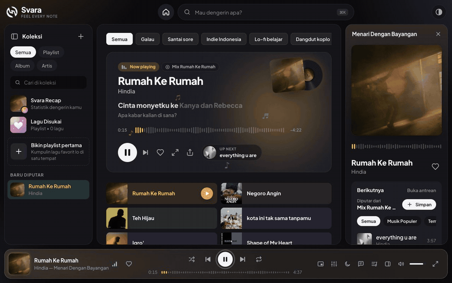
<br><sub>Playing a mix → karaoke lyrics → artist page → light theme</sub>
</div>

## 🎧 What is Svara?

**Svara** is a music player for your computer that plays the whole YouTube Music catalogue without ads. Charts, moods, albums, artists, playlists and endless radio mixes, with lyrics that light up as the song plays, a proper equalizer, crossfade between songs, podcasts, and songs you can save to listen offline.

There's no sign-up and no cloud: your library, playlists and listening history live on your own computer.

## 📥 Download

| | Platform | File | Size |
| :---: | --- | --- | --- |
| 🪟 | **Windows 10 / 11** (64-bit) | [**Svara-Setup-2.0.0.exe**](https://github.com/Hiroyki/Svara/releases/latest/download/Svara-Setup-2.0.0.exe) | ~100 MB |
| 🍎 | **macOS 13 Ventura or newer** (Apple Silicon & Intel) | [**Svara-2.0.0.dmg**](https://github.com/Hiroyki/Svara/releases/latest/download/Svara-2.0.0.dmg) | ~250 MB |

Both downloads are **all-in-one**: everything Svara needs (Python, yt-dlp, Deno and ffmpeg) is already inside. No Homebrew, no Terminal, no extra installs.

<details open>
<summary><b>🪟 Installing on Windows</b></summary>

<br>

1. Run **`Svara-Setup-2.0.0.exe`**.
2. Click **Next → Next → Install → Finish**. That's it.
3. Svara opens on its own (leave *Run Svara* ticked) and appears in the Start menu, plus a desktop shortcut if you want one.

- No admin rights needed: it installs for your user only.
- If SmartScreen shows *"Windows protected your PC"*, click **More info → Run anyway**. The installer just isn't code-signed yet.
- Uninstall from **Settings → Apps → Svara**. It asks whether to keep your library for a later reinstall.

</details>

<details open>
<summary><b>🍎 Installing on macOS</b></summary>

<br>

1. Open **`Svara-2.0.0.dmg`** and drag **Svara** onto **Applications**.
2. Open Svara from Applications.
3. The first time, macOS may say it can't verify the developer (Svara isn't notarised by Apple yet). Go to **System Settings → Privacy & Security**, scroll down and click **Open Anyway**. You only do this once.

- Closing the window keeps the music playing. Quit with **⌘Q**.
- Still blocked? Run this once in Terminal: `xattr -dr com.apple.quarantine /Applications/Svara.app`

</details>

## 🖼️ Screenshots

<div align="center">

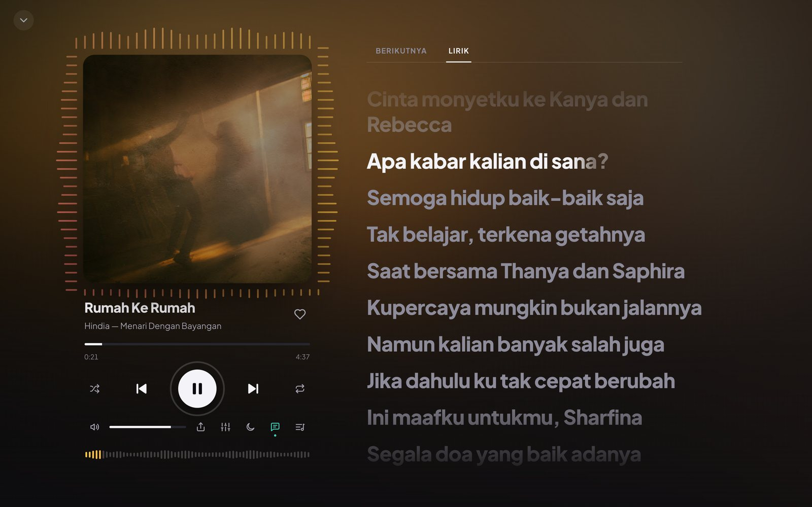
<br><sub><b>Now Playing</b> with karaoke lyrics that follow the song</sub>

<br><br>

<table>
<tr>
<td align="center" width="50%">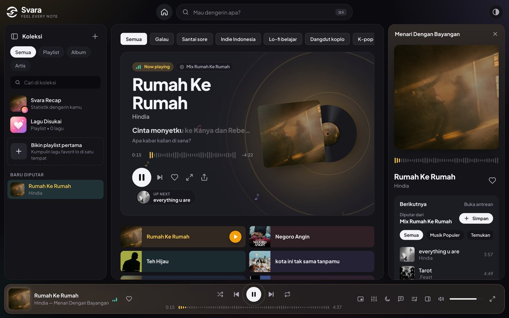<br><sub><b>Home</b>: what's playing, the next lyric line, and your mix</sub></td>
<td align="center" width="50%">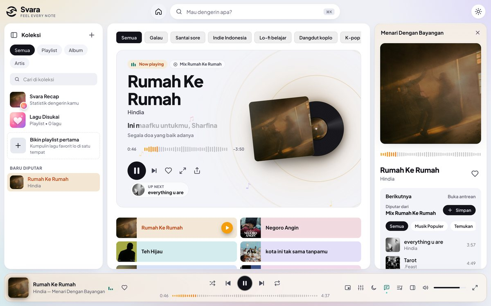<br><sub><b>Light theme</b>, following your system</sub></td>
</tr>
<tr>
<td align="center">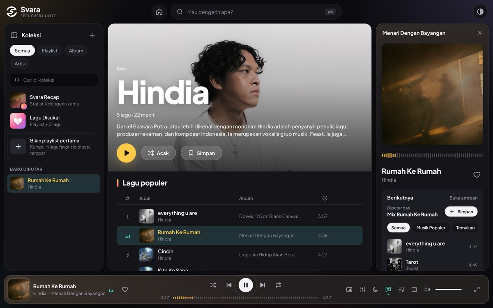<br><sub><b>Artist pages</b> with popular songs and albums</sub></td>
<td align="center">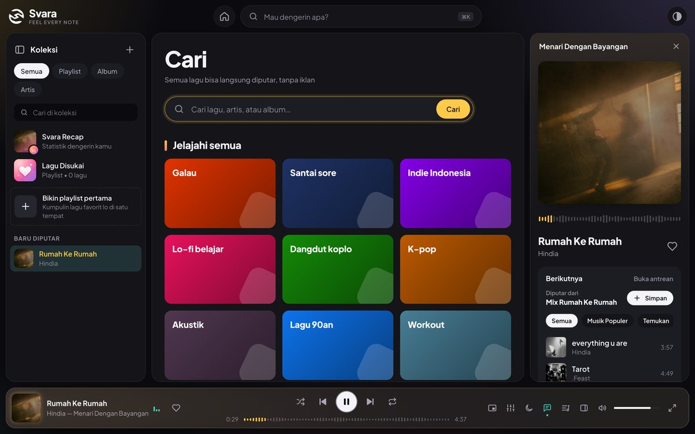<br><sub><b>Search</b> and browse by mood</sub></td>
</tr>
<tr>
<td align="center">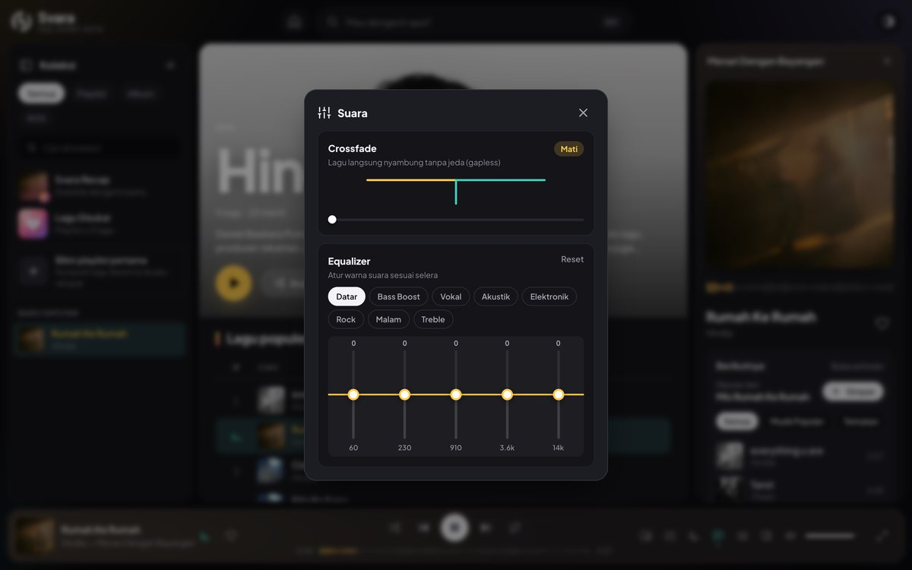<br><sub><b>Sound</b>: crossfade and a 5-band equalizer with presets</sub></td>
<td align="center">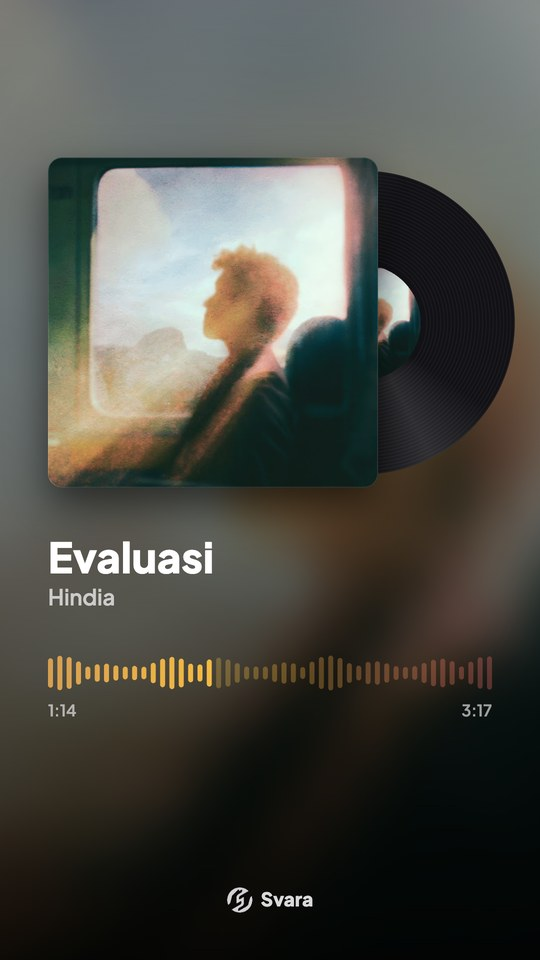 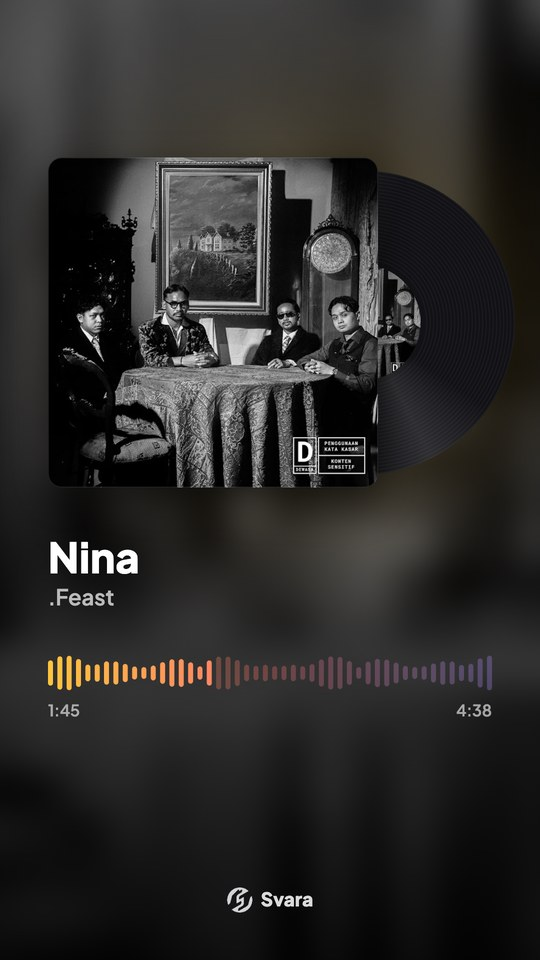<br><sub><b>Story cards</b> to share what you're playing</sub></td>
</tr>
</table>

</div>

## 🎞️ Feature tour

<div align="center">

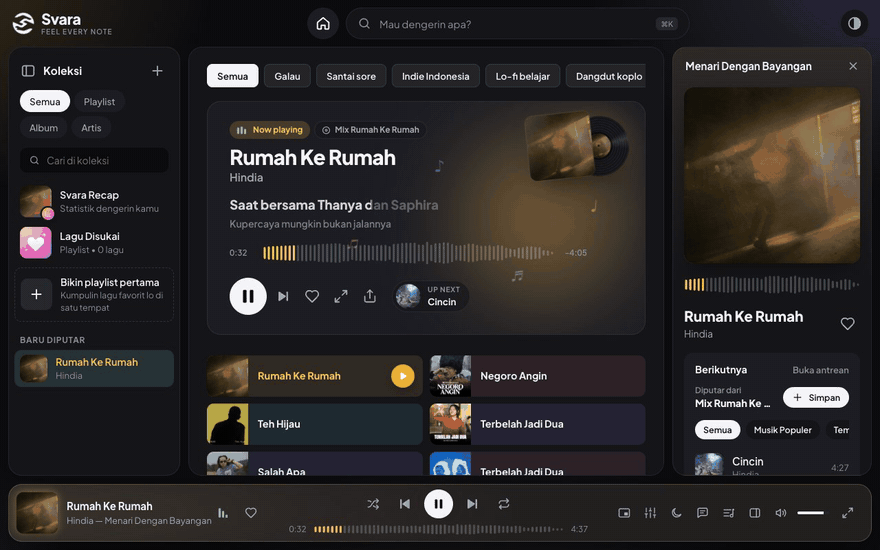
<br><sub><b>Story cards</b>: one click turns the song you're playing (and the lyric line you're on) into a 1080×1920 card</sub>

<br><br>

<table>
<tr>
<td align="center" valign="top" width="50%">
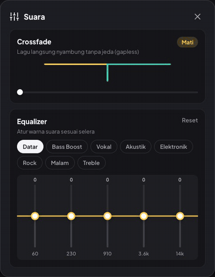
<br><sub><b>5-band equalizer</b>: flat, bass boost, vocal, acoustic, electronic, rock, night and treble presets, or drag your own</sub>
</td>
<td align="center" valign="top" width="50%">
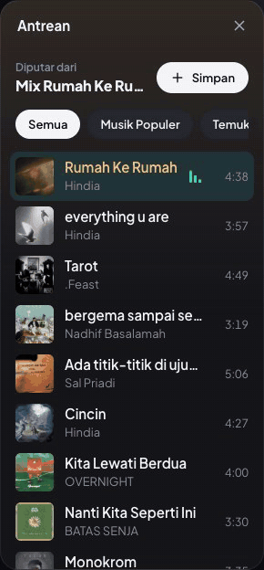
<br><sub><b>Up Next</b>: switch the mood of an endless mix with one tap</sub>
</td>
</tr>
</table>

<br>

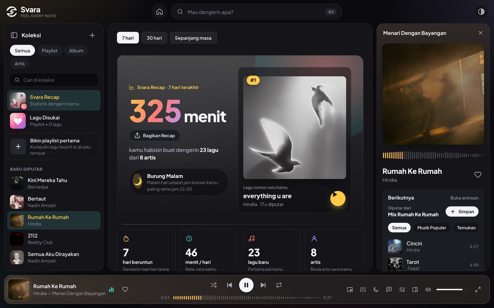
<br><sub><b>Svara Recap</b>: minutes listened, your #1 song, listening persona, streaks and new discoveries <i>(shown with demo listening history)</i></sub>

</div>

## ✨ Features

<table>
<tr>
<td width="33%" valign="top">

### 🎧 Listen
- **Endless Up Next**: radio mixes from any song, with mood chips
- **Smart shuffle** slips in similar songs
- **Gapless crossfade** between tracks
- **5-band equalizer** and live spectrum visualizer
- **Karaoke lyrics**, synced line by line
- **Mini player** that floats over other windows
- **Sleep timer**

</td>
<td width="33%" valign="top">

### 🔍 Discover
- **Adaptive home**: daily mix, "continue listening", recommendations for your country
- **Mood cards**: Galau, Santai sore, Indie Indonesia, Lo-fi, Dangdut koplo, K-pop…
- **Search** songs, albums, artists, playlists and podcasts
- **Album, artist and playlist pages**
- **Podcasts**: subscribe and play episodes

</td>
<td width="33%" valign="top">

### 💛 Yours
- **Library**: liked songs, playlists, albums, artists
- **Save the queue** as a playlist in one click
- **Offline songs** saved to your Music folder
- **Svara Recap**: minutes listened, top songs and artists, streaks
- **Story cards** to share what you're playing
- **Light & dark** themes that follow your system

</td>
</tr>
</table>

## 📸 Story cards

Share what you're listening to as a 1080×1920 card, ready for Instagram or WhatsApp stories. The card takes its colours from the album art, adds the lyric line you're on, and shows how far into the song you are. On macOS it opens the native share sheet (AirDrop, Messages, Photos…); you can also save or copy the image.


## ⌨️ Keyboard shortcuts

| Key | Action | Key | Action |
| --- | --- | --- | --- |
| <kbd>Space</kbd> | Play / pause | <kbd>L</kbd> | Lyrics |
| <kbd>→</kbd> <kbd>←</kbd> | Seek ±10 s | <kbd>M</kbd> | Mute |
| <kbd>⇧</kbd> <kbd>→</kbd> <kbd>←</kbd> | Next / previous song | <kbd>E</kbd> | Sound & equalizer |
| <kbd>↑</kbd> <kbd>↓</kbd> | Volume | <kbd>P</kbd> | Mini player |
| <kbd>⌘K</kbd> / <kbd>/</kbd> | Search | <kbd>?</kbd> | All shortcuts |

## 🔒 Privacy

- **No account, no sign-in.** Svara never asks for your Google login.
- **No ads, no tracking, no analytics.**
- Your library, playlists, history and Recap are stored **only on your computer**.
- The app talks to a small server that runs **on your own machine**, which fetches the catalogue, lyrics and audio for you.

## ❓ FAQ

<details>
<summary><b>Is it free?</b></summary>
<br>
Yes. Svara is free and open source under the MIT license.
</details>

<details>
<summary><b>Do I need a YouTube or YouTube Music account?</b></summary>
<br>
No. Svara works without signing in to anything.
</details>

<details>
<summary><b>Where do saved (offline) songs go?</b></summary>
<br>
Into <code>Music/Senandung</code> in your home folder, as normal audio files you can also play elsewhere.
</details>

<details>
<summary><b>How do I update?</b></summary>
<br>
Download the newest installer from <a href="https://github.com/Hiroyki/Svara/releases">Releases</a> and install over the old one. Your library stays.
</details>

<details>
<summary><b>A song won't play. What now?</b></summary>
<br>
YouTube changes things from time to time; a newer Svara release usually fixes it. On macOS the log lives at <code>~/Library/Logs/Svara.log</code>, on Windows at <code>%LOCALAPPDATA%\Senandung\senandung.log</code>. Please attach it when you open an issue.
</details>

## 🔧 How it works

```
┌──────────────────── Svara app window ────────────────────┐
│   macOS: Swift + WKWebView     Windows: Go + WebView2    │
│   ┌──────────── interface (HTML · CSS · JS) ───────────┐ │
│   │  index.html · app.js · style.css · db.js (library) │ │
│   └─────────────────────────┬──────────────────────────┘ │
└─────────────────────────────┼────────────────────────────┘
                              │  127.0.0.1:5560 (your machine only)
              ┌───────────────┴───────────────┐
              │  server.py (bundled Python)   │──► yt-dlp + Deno  → catalogue & audio
              │  lyrics · images · podcasts   │──► ffmpeg         → offline songs
              └───────────────────────────────┘──► RSS            → podcasts
```

<details>
<summary><b>🛠️ Build it yourself</b></summary>

<br>

Both apps are built from a Mac:

```sh
./build-mac.sh       # → dist/Svara.app + dist/Svara-<version>.dmg
./build-windows.sh   # → dist-windows/Svara.exe + dist-windows/Svara-Setup-<version>.exe
```

You'll need the Xcode command line tools and `brew install uv go makensis`, plus Pillow (`pip3 install pillow`). The scripts download Python, yt-dlp, Deno and ffmpeg for each platform and pack them into the app.

| Path | What |
| --- | --- |
| `index.html` · `app.js` · `style.css` · `db.js` | The interface (no framework, no build step) |
| `server.py` · `ytworker.py` | Local server and always-warm yt-dlp workers |
| `mac/main.swift` | macOS app: window, menus, server lifecycle, native share sheet |
| `windows/` | Windows app (Go + WebView2) and the NSIS installer |

</details>

## 🧰 Built with

<div align="center">


</div>

| | Piece | Used for |
| :---: | --- | --- |
| 🍎 | **Swift + WebKit** | The native macOS window, menus and share sheet |
| 🪟 | **Go + WebView2** | The native Windows window, with Python, yt-dlp, Deno and ffmpeg embedded |
| 🐍 | **Python + [yt-dlp](https://github.com/yt-dlp/yt-dlp)** | The local server that finds songs and streams audio |
| ✨ | **Vanilla JS, HTML & CSS** | The whole interface: no framework, no build step |
| 🎵 | **[LRCLIB](https://lrclib.net)** | Synced lyrics |

## 🇮🇩 Made in Indonesia

Svara is built in Indonesia, and it shows. The name comes from Sanskrit *svara*, a musical note, the same root as the Indonesian word *suara*: sound, voice. The moods are local too: **Galau** (in your feelings), **Santai sore** (lazy afternoon), **Indie Indonesia**, **Dangdut koplo** and more, next to Lo-fi and K-pop. Recommendations follow your own country, wherever you are.

> The app's interface is in Indonesian for now.

## 🤝 Contributing

Bug reports, ideas and pull requests are welcome! Have a look at [CONTRIBUTING.md](CONTRIBUTING.md) for how to run Svara from source, or start a chat in [Discussions](https://github.com/Hiroyki/Svara/discussions).

If Svara makes your day sound better, a ⭐ helps other people find it.

<div align="center">

<a href="https://star-history.com/#Hiroyki/Svara&Date">
  <picture>
    <source media="(prefers-color-scheme: dark)" srcset="https://api.star-history.com/svg?repos=Hiroyki/Svara&type=Date&theme=dark">
    
  </picture>
</a>

</div>

---

<div align="center">


**Svara** · [Changelog](CHANGELOG.md) · [Releases](https://github.com/Hiroyki/Svara/releases) · [Report a bug](https://github.com/Hiroyki/Svara/issues/new/choose) · MIT License

<sub>Svara is not affiliated with YouTube or Google. For personal use.</sub>

</div>
